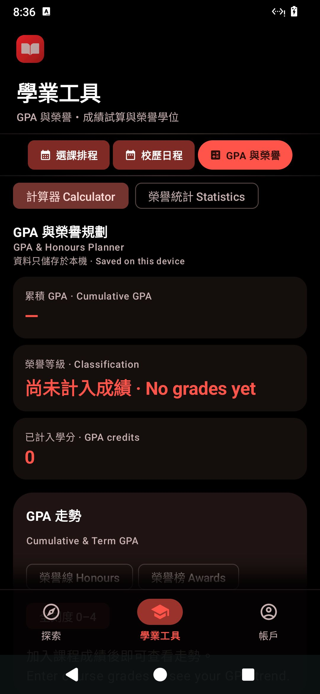
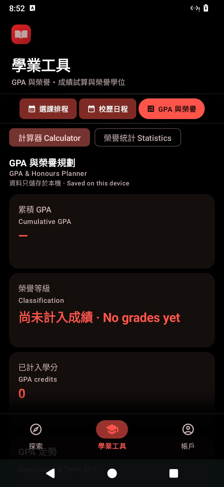
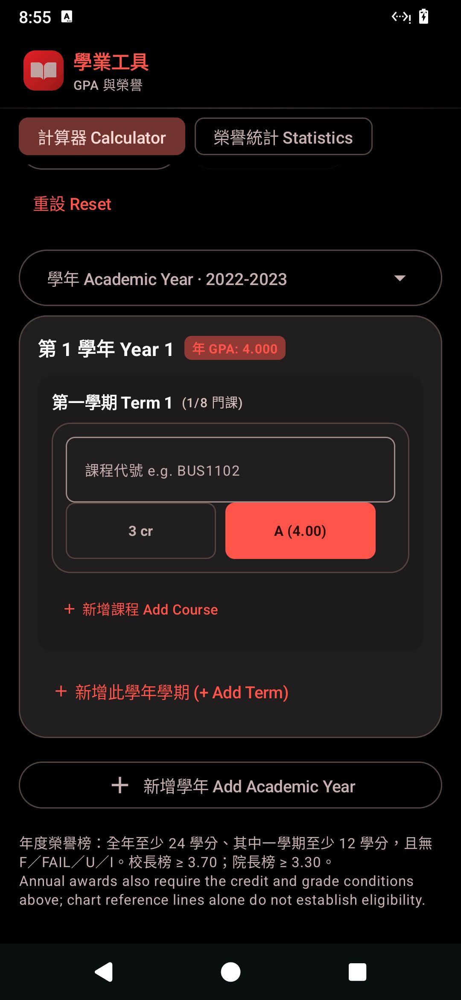
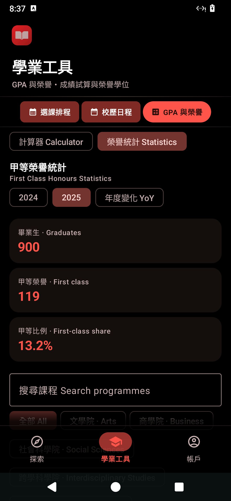
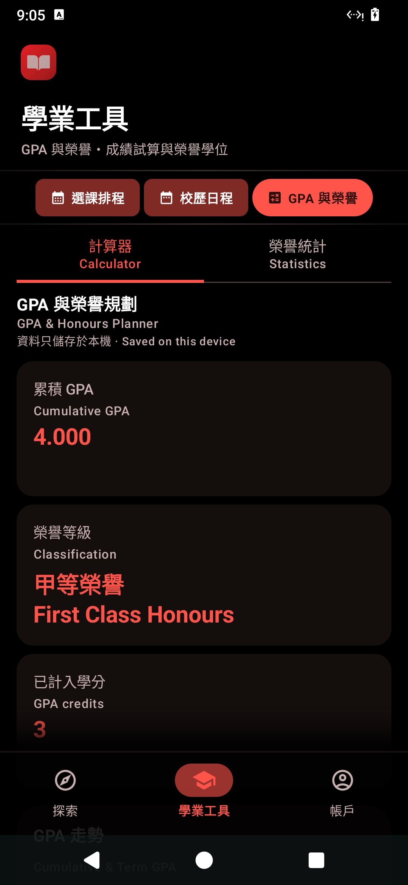
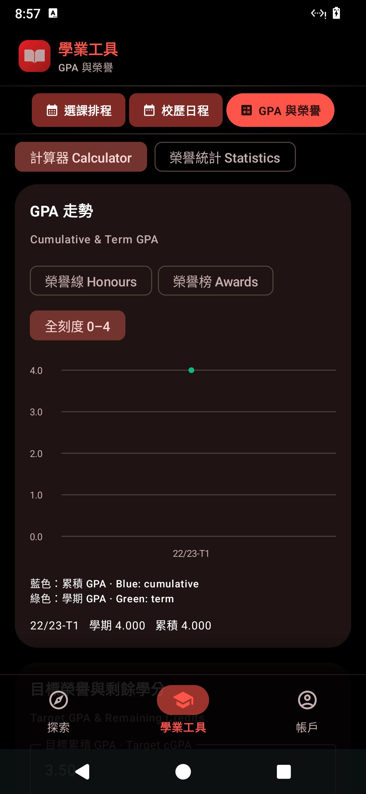

<div align="center">


# LingUBible Android 📱
### *Official Native Android Client for LingUBible — Lingnan University Course & Lecturer Review Platform*

[](README.md)
[](docs/zh-TW/README.md)

[-3DDC84?style=flat-square&logo=android&logoColor=white)](https://developer.android.com)
[](https://kotlinlang.org)
[](https://developer.android.com/jetpack/compose)
[](https://appwrite.io)
[](https://insert-koin.io)
[](https://github.com/ricky688/LingUBible_android)
[](LICENSE)

<br/>

**LingUBible Android** is the official native Android application built for Lingnan University (LU) students. Powered by **Jetpack Compose** and Google's **Material 3 Expressive (M3E)** design language, it pairs pure spring-physics motion, frosted glass surfaces, and full bilingual (Traditional Chinese / English) support with seamless synchronization to the [LingUBible Web App](https://www.lingubible.com) backend—delivering a fast, tactile experience for reading course reviews, planning timetables, tracking academic calendars, and simulating GPA & Honours classifications.

[✨ Features](#-features) • [📱 Screenshots](#-screenshots) • [🏗️ Architecture](#%EF%B8%8F-architecture) • [🚀 Quick Start](#-quick-start) • [🧪 Testing](#-testing) • [📄 License](#-license)

</div>

---

## ✨ Features

### 🎓 1. Academic Tools: GPA & Honours Planner
- **GPA Calculator Tab**:
  - **Numeric Roll Transitions**: Smooth vertical rolling digit animations (`AnimatedContent` + spring physics) for cumulative GPA (cGPA), term GPA, and total credits.
  - **Dynamic Honours Classification Banner**: Automatically evaluates Honours standing (First Class, Second Upper, Second Lower, Third Class) with expressive badges.
  - **Target GPA Simulator**: Set a target GPA and remaining credits (with quick presets such as First Class `3.50` and Second Upper `3.00`) to calculate the required average grade.
  - **Multi-Year Course Editor**: Add or remove academic years and terms, autocomplete course codes, and navigate changes with a full **Undo / Redo / Reset** history stack.
- **Honours Statistics Tab**:
  - **Official Graduation Dataset**: Built-in Lingnan University graduation statistics across 30 programmes for 2024 and 2025 (total graduates, First Class counts, and percentages).
  - **Multi-Dimensional Filtering**: Filter by faculty, search programmes, and compare year-over-year (YoY) trends.

### 📅 2. Academic Calendar
- **Month, Week & Three-Day Views**: Matches Google Calendar and the LingUBible web app with colour-coded event chips (Holiday, Teaching, Exam, etc.) rendered directly in day cells.
- **Official Academic Schedule**: Synchronizes Lingnan University key dates (term start, Add/Drop periods, exam weeks, holidays) with detailed daily event sheets.

### 🗓️ 3. Timetable Planner
- **Expandable Category Filter**: Smoothly expands from a compact bar into a multi-column subject grid for instant course filtering.
- **Conflict Detection & Customization**: Select lecture/tutorial sections with automatic time-conflict alerts, per-term custom titles, colours, and credit deduplication.
- **Export & Sharing**: Export timetables as **PNG**, **PDF**, or standard **`.ics` calendar files**, and share/import timetable links compatible with the web app.

### 🔍 4. Discover, Courses & Instructors Directory
- **Smart Search & Filters**: Search by course code (e.g. `CLC9001`, `BUS1102`), English/Chinese titles, instructor names, or common student nicknames, with recent search history.
- **Material 3 Expressive Motion**: Shared container transforms when opening course and instructor details, independent floating 18 dp cards, and interactive Vico grade distribution charts.
- **Course Resources**: Browse required/recommended readings, past papers, and study materials with a built-in PDF viewer and single-file or bulk ZIP downloads.

### ✍️ 5. Course Reviews & Community Voting
- **Multi-Criteria Ratings**: Evaluate Workload, Difficulty, Grade Leniency, and Teaching Quality (including 0.0 / N/A support) per lecture/tutorial session.
- **Community Voting & Drafts**: Helpful/Unhelpful review voting, account-scoped 7-day review drafts, eligibility checks, and personal review editing/deletion.

### 🔐 6. Authentication, Profile & App Links
- **Lingnan Student Verification**: Native email and Google OAuth sign-in restricted to valid `@ln.hk` student accounts, plus native password recovery/reset.
- **Profile & Appearance**: Custom animal avatars, OLED pure black & Material You dynamic palettes, and smooth M3 Expressive loading/spreading transitions.

---

## 📱 Screenshots

<div align="center">

| GPA Calculator | Target GPA Simulator |
|:---:|:---:|
|  |  |

| Course & Term Editor | Honours Statistics |
|:---:|:---:|
|  |  |

| Themed Tabs | Grade Distribution Chart |
|:---:|:---:|
|  |  |

</div>

---

## 🎨 Design System: Material 3 Expressive (M3E)

LingUBible Android follows Google's **Material 3 Expressive** standards:

1. **Pure Spring Motion Tokens**: Unified `MotionScheme.expressive()` and stiffness-only springs (`AppMotion`) with no artificial damping-ratio overrides.
2. **Expressive Shapes & Button Morphing**: Global `8.dp` pressed corner-radius morphing (`AppButtonDefaults`) across all buttons, paired with `18.dp` floating expressive cards and container transforms (`ContainerTransform`).
3. **Frosted Glass Surfaces**: Translucent surface layers with subtle vertical highlight borders and scroll-edge fades (`fadingVerticalScroll` / `FadingLazyColumn`).
4. **Bilingual Visual Hierarchy**: Clear primary/secondary typography for both English and Traditional Chinese interfaces.

---

## 🏗️ Architecture

Built following Clean Architecture + MVVM + Repository Pattern:

```text
LingUBible_android/
├── app/
│   ├── src/main/java/com/lingubible/app/
│   │   ├── core/                    # Theme, navigation routes, settings, motion tokens, i18n
│   │   │   ├── navigation/          # NavGraph, BottomBar, TopBar, Drawer
│   │   │   ├── settings/            # AppSettingsManager (DataStore)
│   │   │   ├── theme/               # Theme, Color, Type, AppMotion
│   │   │   └── util/                # I18n, IcsExporter
│   │   ├── data/                    # Data sources & repository implementations
│   │   │   ├── remote/              # AppwriteClientProvider (Appwrite SDK)
│   │   │   └── repository/          # Auth, Course, Instructor, Review, Calendar, Timetable
│   │   ├── di/                      # Dependency injection (Koin modules)
│   │   ├── domain/                  # Domain models, repository interfaces & business logic
│   │   │   ├── calculator/          # HonoursCalculator
│   │   │   ├── model/               # Domain entity models
│   │   │   └── repository/          # Repository interfaces
│   │   └── ui/                      # Presentation layer (Jetpack Compose)
│   │       ├── common/              # Shared modifiers & haptic helpers
│   │       ├── components/          # M3E components (ContainerTransform, Charts, Modals)
│   │       └── screens/             # Feature screens (Home, Courses, Planner, Calendar, GPA, Profile)
│   └── src/test/                    # JVM unit test suite
```

### 🧰 Tech Stack

| Area | Technology | Version | Purpose |
|:---|:---|:---|:---|
| **Language** | Kotlin | `2.0.0` | Coroutines, Flows & type safety |
| **UI Framework** | Jetpack Compose | BOM `2026.09.00` | Declarative native UI |
| **Design System** | Material 3 Expressive | `1.5.0-alpha01` | M3E expressive components & motion |
| **Dependency Injection** | Koin | `4.0.0` | Lightweight Compose DI |
| **Backend (BaaS)** | Appwrite Android SDK | `27.2.0` | Auth, TablesDB, Storage & Functions |
| **Charts** | Vico Charting | `2.0.2` | Grade distribution bar charts |
| **Async** | Kotlin Coroutines & Flow | `1.8.1` | Reactive state & concurrency |
| **Image Loading** | Coil Compose | `2.7.0` | Async image loading & caching |
| **Testing** | JUnit 4 + MockK + Turbine | Latest | Domain, calculator & ViewModel tests |

---

## 🚀 Quick Start

### Prerequisites
- **Android Studio**: Ladybug (2024.2.1) or newer
- **JDK**: Java 17
- **Android SDK**:
  - `compileSdk`: 36
  - `targetSdk`: 36
  - `minSdk`: 26 (Android 8.0 Oreo+)

### 1. Clone the Repository
```bash
git clone https://github.com/ricky688/LingUBible_android.git
cd LingUBible_android
```

### 2. Appwrite Configuration
The project is preconfigured with the production Appwrite endpoint in `app/build.gradle.kts`:
- **Endpoint**: `https://appwrite.lingubible.com/v1`
- **Project ID**: `6a1097400037a55f6472`
- **Database ID**: `lingubible`

*(To point to a custom Appwrite instance, update the `buildConfigField` values in `app/build.gradle.kts`.)*

### 3. Build & Install Debug APK
```bash
# Set Android SDK path if not already in environment
export ANDROID_HOME=/path/to/android-sdk

# Build debug APK
./gradlew :app:assembleDebug

# Install via ADB
adb install -r app/build/outputs/apk/debug/app-debug.apk
```

---

## 🧪 Testing

Run the full offline JVM unit test suite (556 tests covering GPA/Honours calculations, timetable credit deduplication, email validation, scrollbar geometry, and ViewModel states):

```bash
./gradlew :app:testDebugUnitTest --console=plain
```

For Play release verification (R8 optimization, mapping consistency, and navigation enum preservation):

```bash
./gradlew :app:assembleRelease :app:bundleRelease
python3 tools/verify-play-release.py
```

---

## 🤝 Contributing

Contributions are welcome!
1. Fork the repository.
2. Create your feature branch: `git checkout -b feature/awesome-feature`.
3. Follow the project's Material 3 Expressive design guidelines and include unit tests.
4. Commit your changes: `git commit -m '✨ Add awesome feature'`.
5. Push to the branch: `git push origin feature/awesome-feature`.
6. Open a Pull Request.

---

## 📄 License

This project is open-sourced under the [MIT License](LICENSE).

---

<div align="center">

**Made with ❤️ for all Lingnan University Students**  
*Let every review be a guiding light on your learning journey.*

</div>
